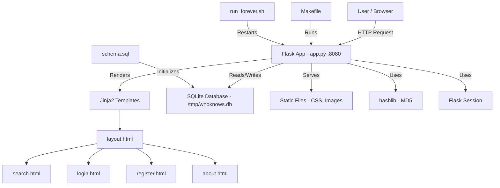
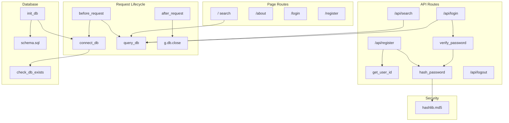

# Dependency Graph — WhoKnows Legacy Application

## Overview

The WhoKnows application is a monolithic Flask search engine. All backend logic resides in a single file (`app.py`), which makes the dependency graph relatively flat but tightly coupled.

## System-Level Dependency Graph



## Internal Module Dependency Graph (app.py)

Since the entire backend lives in `app.py`, the internal dependencies are between functions:



## Package Dependencies

| Package | Version | Purpose |
|---------|---------|---------|
| Flask | 0.5 | Web framework |
| Jinja2 | 2.4 | Template engine |
| Werkzeug | 0.6.1 | WSGI utility library (Flask dependency) |
| setuptools | 44.1.1 | Package management |
| sqlite3 | stdlib | Database (Python standard library) |
| hashlib | stdlib | Password hashing (MD5) |

## File Structure

```
src/
├── Makefile              → Build commands (init, run, test)
├── run_forever.sh        → Bash restart loop
├── schema.sql            → DB schema + seed data
├── README.md             → Setup instructions
└── backend/
    ├── app.py            → ALL application logic (routes, DB, auth)
    ├── app_tests.py      → Unit tests (incomplete)
    ├── requirements.txt  → Python dependencies
    ├── static/
    │   ├── style.css     → Styling
    │   └── monkgroup.png → Team image
    └── templates/
        ├── layout.html   → Base template
        ├── search.html   → Search page
        ├── login.html    → Login form
        ├── register.html → Registration form
        └── about.html    → About page
```

## Key Observations

- **No separation of concerns**: routes, database logic, security functions, and configuration all live in a single `app.py` file.
- **No external service dependencies**: the app is entirely self-contained with SQLite as a file-based database.
- **Tight coupling**: every route directly calls `query_db` with raw SQL — there is no data access layer or ORM.
- **Python 2 dependency**: the Makefile explicitly calls `python2`, and the code uses Python 2 print syntax.
